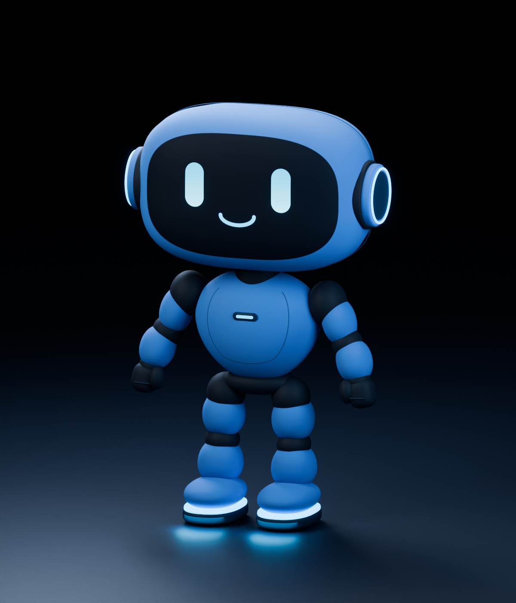

# MERLIN

**A friendly robot home assistant that lives on a screen in your home. You talk, he answers out loud and gets things done.**

Built on Meta's Muse models for the **2026 Meta Global AI Developer Hackathon**.



## MERLIN in 30 seconds

Say "MERLIN" and ask for something. A small 3D robot on a wall or counter screen hears you, answers in his own voice, and acts it out: he thinks, searches, and pulls out a panel for whatever you asked about.

- **Talk instead of typing.** He listens for his name, knows when you've finished talking, lets you interrupt, and keeps the conversation going until it goes quiet.
- **He gets things done.** Timers, web searches, lights, the oven, Spotify, and your own routines ("when I say goodnight, turn off the lights").
- **He remembers your household.** Preferences and facts are learned from conversations with him, and you can see, edit or delete all of it.
- **He follows your rules.** "Never talk about politics" or "always use Celsius" is checked against every reply and every action.
- **He asks before using his camera.** Ask "Does my outfit match?" and he asks first, takes one picture, answers, and then throws the picture away.

## Try it: demo mode

Demo mode starts MERLIN with a **simulated home** already connected, so you can try device control without any smart-home hardware.

You need Node.js 22.16 or newer, a Meta Model API key, Chrome or Safari, and Python 3.12 (or `uv`) for MERLIN's local voice.

```bash
git clone https://github.com/Darthfranco/MERLIN.git
```

```bash
cd MERLIN && npm ci && cp .env.example .env
```

Put your key in `.env` as `META_API_KEY=...`. Then:

```bash
npm run setup:voice
```

```bash
npm run demo
```

`setup:voice` is a one-time step that downloads MERLIN's voice and wake-word models. After `npm run demo`, open **<http://127.0.0.1:3000/companionfull/>**, tap once so the browser allows sound, say "MERLIN", and try:

- "Turn on the kitchen lights."
- "Preheat the oven to 400."
- "Set a pasta timer for eight minutes."
- "Look up the weather in Brooklyn."
- "When I say movie night, turn off the living room lights."
- "Does my outfit match?"

The **Connection Center** is at **<http://127.0.0.1:3000/connections/>**. You can also just ask MERLIN "How do I connect my lights?"

**What's in the demo home:** living room, kitchen and gym lights, a gym speaker and an oven. They are simulated: nothing physical is controlled, they reset when the server restarts, and the app labels them "Demo device · simulated". Run `npm start` instead of `npm run demo` to get MERLIN with only the services you really connect.

## How MERLIN uses Meta's models

| What MERLIN does | Meta model |
| --- | --- |
| Understands you, decides what to do, calls tools, writes the reply | **Muse Spark 1.3** |
| Searches the web and reads pages it found | Muse Spark's built-in web search |
| Turns your speech into text | **Muse Voice Transcribe 1.0** |
| Looks through his own camera | **SAM 3.1** finds what's in the picture, Muse Spark explains it |
| Learns household memories in the background | Muse Spark |
| Says a short "checking the weather in Brooklyn" line while a search runs | Muse Spark (a separate small call) |
| Artwork on routine panels | **Muse Image 1.0** |

MERLIN's voice is [Kokoro](https://github.com/hexgrad/kokoro) (Fenrir voice), running on your machine. Listening for "MERLIN" also happens on your machine; nothing is sent to the cloud until he hears his name.

## How it works

```text
 microphone ─► "MERLIN" heard locally ─► Muse Voice Transcribe
                                               │
 memory + your rules ─────────────────► Muse Spark ─► timers · search · devices · Spotify · camera
                                               │            (real results, written by code)
                              every reply and action checked against your rules
                                               │
                     Kokoro voice (local)  +  3D robot and panels on screen (three.js)
```

The model decides what to do. The code carries it out and reports what actually happened. MERLIN never says a light turned on unless the device reported it.

## What works today

| Works | Simulated | Not built yet |
| --- | --- | --- |
| Voice conversation with wake word and interruptions | Demo home devices (`npm run demo`) | Home cameras and doorbells (e.g. Ring) |
| Web search, with sources | | Schedules ("every weekday at 7") |
| Timers, several at once | | Calendar |
| Memory you can inspect and delete | | Location triggers ("preheat when I'm 5 minutes away") |
| Standing rules and custom routines | | Phone app connected to the home display |
| Camera that asks first | | |
| Spotify (you tap to play) | | |
| Connectors for Home Assistant, Philips Hue, Shelly, SwitchBot and Rachio | | |

The real device connectors are written and tested against simulated device APIs, but have not been tried on real hardware yet. See [ROADMAP.md](ROADMAP.md) for the honest list of what's next.

## Privacy

- Everything MERLIN remembers stays in `data/` on your machine, and one button clears all of it.
- The microphone is visibly on, and idle audio never leaves the machine.
- Camera pictures go only to the two Meta vision requests and are never saved.
- Device and Spotify passwords and tokens stay on the server and never reach the browser, the logs, or Meta.

## Built during the hackathon

Everything in this repository was built during the hackathon, starting at kickoff on October 26, 2026. The git history shows the work day by day.

Third-party pieces it uses:

- [three.js](https://threejs.org/) (MIT) for the 3D robot, copied into `assets/merlin-character/viewer/vendor/three/`
- [`ws`](https://github.com/websockets/ws) (MIT), the only npm dependency
- [Kokoro](https://github.com/hexgrad/kokoro) (Apache-2.0) and [sherpa-onnx](https://github.com/k2-fsa/sherpa-onnx) wake-word and voice-detection models, downloaded by `npm run setup:voice`
- Blender 4.0 to build the robot and his animations (source files are in `assets/merlin-character/`)

## Project map

| Folder | What's in it |
| --- | --- |
| `src/` | The server: assistant, memory, rules, routines, timers, voice, camera and device connectors |
| `public/companion/` | The home display (`/companionfull/`) |
| `public/connections/` | The Connection Center |
| `assets/merlin-character/` | The Blender robot, his animations, and an animation studio |
| `test/` | Automated tests. Run `npm test`, no API key needed |
| `docs/` | Guides for each feature. Start at [docs/README.md](docs/README.md) |

More: [ROADMAP.md](ROADMAP.md) (known issues and next steps) · [docs/STATUS.md](docs/STATUS.md) (current state) · [AGENTS.md](AGENTS.md) (instructions for coding assistants)
