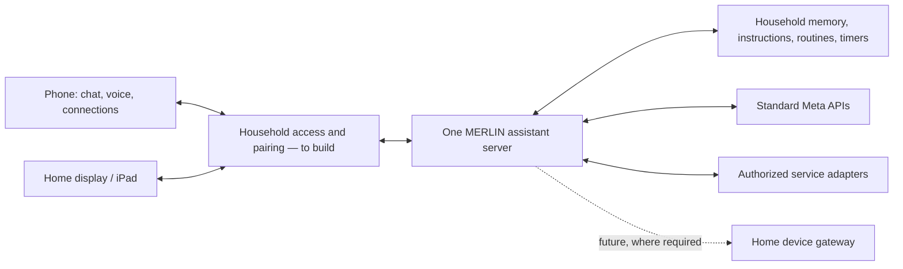

# Hosting MERLIN: home computer, home server, or cloud

This guide helps you choose where MERLIN could live and gather the tools to run it. You can run the current assistant on one host today. Connecting the phone and home-display apps to a shared household is a separate implementation step.

**Current release, October 27, 2026:** the real assistant and home-display interface run on a loopback-only Node server. The phone app is an independent local demo. There is no household sign-in, device pairing, shared phone storage, or supported public deployment yet. The examples below do not connect the apps or enable remote access automatically.

## Choose a route

| Route | Good fit | Tools you would need | Ongoing responsibility | Available today |
| --- | --- | --- | --- | --- |
| **Mac mini or another Mac at home** | You want the assistant's stored data and voice worker at home | Git, Node.js, optional Python/uv for voice, optional launchd starter | Keep the Mac awake; install updates; protect and back up its data | Local assistant and separate phone preview; optional local startup template |
| **Linux home server or a Linux VM on a NAS** | You already maintain an always-on machine | Git, Node.js, SSH, optional Python/uv, systemd starter | Linux updates, storage, power recovery, backups | Local assistant; private administration through SSH; optional startup template |
| **Cloud virtual machine (VPS)** | You prefer to rent a server and administer it yourself | VPS account, Linux VM, SSH keys, Git, Node.js, persistent storage, systemd | Hosting bill, security updates, backups, service availability | Current assistant can be evaluated privately through SSH; phone pairing and remote household use remain future work |
| **Managed cloud app service** | You want a provider to manage more of the server lifecycle | Hosting account, supported Node runtime, persistent disk, secrets, HTTPS/WebSocket support | Service configuration, storage, costs, restore testing | Planning only: current network/storage assumptions need deployment work |
| **Hybrid: home server plus private remote access** | You want local data/device access and eventual access while away | Home-host tools plus a private network such as Tailscale, or a future authenticated gateway | Both home availability and access controls | A future shared-app route; installing a VPN alone does not connect today's apps |

These are options, not a selected provider or a hardware purchase requirement. Start with a machine you already have. The hosted Meta text path does not require a local model GPU. Voice workers, character rendering, and concurrent devices need measurements on your target hardware; MERLIN has no published minimum RAM, CPU, or latency benchmark. Hosting, storage, backup, and Meta usage costs are separate; check your provider's current plans before provisioning.

## What would be shared

The intended architecture is one household assistant with two interfaces:



Both interfaces would use the same memory and service authorization. Replies and device updates would return to the appropriate screen. The phone's existing mock connections are not live credentials; its browser history and attachments do not become server data merely by hosting the files. Importing demo data would need an explicit migration choice. See [phone scope](PHONE.md) and [current assistant orchestration](ORCHESTRATION.md).

## Start with the current local assistant

These steps run the existing application on the chosen host. They do **not** make it reachable from another phone or iPad.

1. Install [Git](https://git-scm.com/downloads/) and a maintained [Node.js LTS release](https://nodejs.org/en/download) meeting the repository's minimum, **22.16.0**. npm is used for the pinned dependencies. For optional local voice, install [uv](https://docs.astral.sh/uv/getting-started/installation/) or Python 3.12 and follow [voice setup](VOICE.md).
2. Clone the public code and install its dependencies:

   ```sh
   git clone https://github.com/Darthfranco/MERLIN.git
   cd MERLIN
   npm ci
   node scripts/hosting-doctor.mjs
   ```

   The doctor reports prerequisites and current deployment limitations. It does not install anything, read secret values, call providers, or certify remote deployment readiness. See the [toolkit](../deploy/README.md).

3. If `.env` does not already exist, create your private configuration:

   ```sh
   if [ ! -e .env ]; then cp .env.example .env; fi
   chmod 600 .env
   ```

   Edit `.env` in your editor and set `META_API_KEY` on this host. Keep standard `META_MODEL=muse-spark-1.3` unless following a separately verified model change. Do not paste credentials into the app, commands, GitHub issues, or screenshots. `.env` and runtime `data/` are ignored by Git.

4. Run the optional authenticated model-access check, then the assistant:

   ```sh
   npm run check:meta
   npm start
   ```

   `check:meta` contacts Meta; it is distinct from the offline doctor. On the same host, open [the home-display interface](http://127.0.0.1:3000/companion/) or [the text/memory test interface](http://127.0.0.1:3000/). Without a key, direct manual timer testing remains available. Stop with Ctrl+C before replacing a foreground run with a startup service.

5. To preview the independent phone UI, use another terminal in the checkout:

   ```sh
   npm run phone
   ```

   Open [the phone demo](http://127.0.0.1:3003/) on that same computer. It needs no Meta key. It remains a separate demo with browser-local data.

For voice, run `npm run setup:voice` once as described in [VOICE.md](VOICE.md); this downloads dependencies and model files. It is optional for text. The host's voice runtime is separate from the browser microphone and speaker permissions. See [current limitations](ORCHESTRATION.md#run-the-combined-surface) before expecting unattended audio or alarms.

## Route A: Mac mini or another Mac

1. Use a private macOS account and a stable checkout location. Complete the local setup above while logged in as the account that will run MERLIN.
2. Configure the Mac's energy settings for your intended availability. A display can sleep while the computer remains awake. Apple's [Mac mini server guide](https://support.apple.com/en-gb/guide/mac-mini/apd05a94454f/mac) describes system-sleep prevention, firewall settings, and automatic restart after power loss. Account for disk-unlock/login after a restart; power recovery alone is not proof that MERLIN is running.
3. Test text and, optionally, local Fenrir output in the foreground. Use the [macOS startup example](../deploy/README.md#macos-launchagent) only after that succeeds. It uses absolute paths and loads your existing private `.env`.
4. The supplied example is a **per-user LaunchAgent**. It starts at that user's login, not before login, and stops at logout. A boot-time daemon is a separate administrator setup, not included. Apple's [launchd guide](https://developer.apple.com/library/archive/documentation/MacOSX/Conceptual/BPSystemStartup/Chapters/CreatingLaunchdJobs.html) explains the distinction.
5. Set up encrypted backups and a recovery check before relying on the machine. Keep the local network boundary unchanged until shared-app access is implemented.

**Expected result now:** MERLIN runs on the Mac itself. Typing the Mac's LAN address into an iPad will not work with this checkout's loopback restrictions.

## Route B: Linux home server or NAS-hosted VM

1. Use a maintained Linux system with a supported Node runtime. A NAS can be a candidate host through a compatible Linux VM, but MERLIN has no tested native NAS package or container image. Do not assume every ARM board or NAS can run the optional voice dependencies.
2. Create or use an unprivileged service account, then clone and perform the local setup as that account. Give it ownership of its checkout and private runtime files. Administration can happen over SSH; MERLIN itself stays bound to loopback.
3. Keep the checkout and its `data/` on durable storage. The current command-line server uses **`MERLIN/data/` relative to the checkout**, not a configurable `DATA_DIR` environment variable. A different working directory does not relocate those records.
4. Use the [Linux systemd example](../deploy/README.md#linux-systemd) to supervise the current process if desired. It has explicit paths, an unprivileged account, and restart-on-failure behavior. Review the [systemd service manual](https://www.freedesktop.org/software/systemd/man/latest/systemd.service.html) for your distribution.
5. Test a restart, backup, and restore privately. For a headless machine, use the SSH viewing method below from an administrator's computer.

**Expected result now:** one private assistant process with persistent host storage. A home-device gateway, hardware adapters, and phone pairing are not supplied by systemd or the NAS.

## Route C: cloud virtual machine

This route is a private development/evaluation setup today. A VPS is a remote computer you administer; it does not add a household login to MERLIN.

1. Choose a Linux VM provider and region after reviewing data residency and cost. [DigitalOcean's VM creation guide](https://docs.digitalocean.com/products/droplets/how-to/create/) is one concrete example, not a MERLIN provider selection. Its [SSH guide](https://docs.digitalocean.com/products/droplets/how-to/connect-with-ssh/) covers account/key access.
2. Set up an unprivileged account and restrict administrative access to your intended administrators. Leave MERLIN ports **3000–3003 closed to public inbound traffic**. Do not upload household data or enable voice just to test hosting.
3. Follow the Linux route and common setup on the VM. Store `.env` there privately. Use durable storage for the full `data/` directory, and make encrypted backups outside the VM. One assistant process owns these files.
4. View it privately through an SSH local forward from your administrator computer. This works with the existing loopback boundary and needs no reverse proxy:

   ```sh
   ssh -N -o ExitOnForwardFailure=yes \
     -L 127.0.0.1:3000:127.0.0.1:3000 YOUR_USER@YOUR_HOST
   ```

   Replace the placeholders; the remote assistant must already be running on port 3000. Keep the SSH command open and browse `http://127.0.0.1:3000/companion/` on the administrator computer. Its local port 3000 must be free. If you deliberately use another assistant `PORT`, both forwarding port numbers and the browser URL must match it because MERLIN validates the Host header. Ctrl+C closes the forward. This is an administrator viewing method, not phone pairing. See [OpenSSH local forwarding](https://man.openbsd.org/ssh.1).

5. Keep wake-mode microphones off in a cloud-hosted evaluation. The current voice browser streams standby audio to its Node host for keyword detection. If that host is in a cloud region, idle room audio leaves the home. A future cloud voice deployment must first put wake-word/activity detection on the device or a home gateway and send only activated speech onward. See [voice data flow](VOICE.md#data-flow-and-boundaries).

**Expected result now:** a private remotely hosted assistant view on an administrator computer. Hosting alone does not enable shared phone memory, local appliance discovery, or reliable mobile background notifications.

## Route D: managed cloud application hosting

**Planning only for this release.** Managed web hosting needs an application deployment adapter, not just the `npm start` command copied into a dashboard.

Use a provider that supports a long-running Node process, durable private storage, secret configuration, HTTPS, and WebSockets. For example, Render's [web service requirements](https://render.com/docs/web-services#port-binding) require binding to `0.0.0.0`; MERLIN currently binds only to `127.0.0.1` and permits loopback Host/Origin values. That mismatch must be solved as part of the authenticated deployment design, rather than removing the checks to get a green deployment.

Before following a provider's deployment wizard, a maintainer must supply:

- A reviewed external URL, proxy-trust and authentication configuration that covers HTTP **and** voice WebSocket requests, with pairing/revocation for household devices.
- A documented persistent storage location and secret setup. Render's [disk documentation](https://render.com/docs/disks) says only the mounted path persists, and disk-backed services are limited to one instance. The current MERLIN CLI writes into its checkout's `data/`; a deployment must preserve that actual path or add an explicit supported configuration.
- One writer for memory, routines, timers, and retry receipts. Do not autoscale multiple processes over these JSON files. Persistent storage alone does not turn them into a distributed database.
- WebSocket reconnect and cancellation behavior through deploys. Render documents [WebSocket support](https://render.com/docs/websocket); support at the provider does not verify MERLIN's voice behavior there.
- On-device/home wake detection for cloud voice, a plan for local-only devices, backup/restore, and a tested rollback. Local voice models require additional compute/storage; a static-site service cannot run them.

No managed-cloud manifest or one-click deployment is included because these application changes have not been implemented or verified.

## Future shared access: home network or away from home

These are design options to evaluate **after** the shared-app work below:

| Access option | Tools | What it provides | What MERLIN still needs |
| --- | --- | --- | --- |
| Private network | [Tailscale](https://tailscale.com/docs/features/tailscale-serve) on permitted devices; optional Serve | Private device connectivity and a tailnet-only HTTPS service | Supported network origin, household identity, permissions, and phone synchronization; Serve is not an app login |
| Home LAN with HTTPS | DNS/name setup plus a proxy such as [Caddy](https://caddyserver.com/docs/automatic-https) | An encrypted browser endpoint for home devices | Trusted certificates on each client, authentication, exact allowed origins, and shared state |
| Cloud or hybrid endpoint | Provider HTTPS, an identity service, and a future home gateway where needed | A reachable service while away | Device pairing, revocation, protected storage, live updates, and narrowly authorized home-device actions |

A proxy or VPN does not bypass the implementation gap. Keep Host/Origin protections; do not rewrite arbitrary public traffic to look like trusted localhost. Caddy's local certificates need their CA trusted on each phone/iPad as well as the host. Browser microphone access needs a secure context and user permission; a plain `http://192.168.…` address does not provide the localhost exception. See [browser microphone requirements](https://developer.mozilla.org/en-US/docs/Web/API/MediaDevices/getUserMedia).

### Work required before a household can pair both apps

1. Add a supported server connection mode to the phone, keeping the demo clearly separate. Route text, voice, attachments, and connection settings through real APIs rather than its mock engine/browser store.
2. Implement household identity and device pairing with session expiration and revocation. Existing conversation IDs are not authentication credentials.
3. Choose where authoritative memory, instructions, chat history, files, service tokens, timers, and routines live. Keep explicit instructions separate from learned preferences. Make edits and deletion propagate to every connected client and pending job.
4. Add authenticated updates, reconnect/resume, conversation handoff, and duplicate-action protection across devices. Define which device speaks or alerts; opening two screens must not execute an action twice.
5. Add supported network/HTTPS configuration, preserve origin checks, and update provider OAuth callbacks for the actual URL. The current typed Spotify integration uses a loopback callback; it cannot inherit a new cloud URL automatically. Spotify voice control and alarms remain unavailable.
6. Verify on real phone/iPad browsers: login/logout, network loss, memory changes, file deletion, rejected unauthorized actions, interrupted voice, and timer completion. Sleeping/offline clients must not claim guaranteed alerts.

These are pending engineering tasks, not installation steps a user can complete by changing an environment variable. No hosting provider or final deployment architecture is selected by this guide.

## Data, backup, and recovery

Hosting at home controls where MERLIN's stored files live. It does **not** make the assistant fully offline: the real assistant sends selected request/context data to standard Meta, and activated speech goes to Meta transcription. See [model/privacy boundaries](MODELS.md) and [memory retention](MEMORY.md). A cloud host additionally stores runtime files with that provider. The phone demo sends no model calls, but its browser data is separate from those files.

| Item | Where it lives now | Handling |
| --- | --- | --- |
| API key and local configuration | Ignored `.env` on the assistant host | Restrict access; use protected secret storage/backups; never commit |
| Memory, routines, learning queue, timers, retry receipts, Spotify tokens | Ignored checkout `data/` | Stop the single assistant writer before taking a consistent copy; encrypt backups |
| Voice dependencies and model downloads | Ignored `local/` and caches described in VOICE.md | Rebuild with the setup scripts; retain any separate configuration privately |
| Phone-demo messages, preferences, files, mock connections | That browser/origin's localStorage and IndexedDB | Host backups do not include these; no automatic cloud migration or cross-device restore |

For a private backup: stop MERLIN through the same terminal/service that started it, copy the full `data/` directory to encrypted storage, protect configuration separately, record the code revision, then restart and verify. Exclude process lock files from restored backups. Never copy data between two running instances or run both on one store. Test restores in an isolated private checkout with service actions disabled/disconnected and synthetic data first. Restoring an old backup may restore deleted records and tokens; apply your retention/deletion policy to backups too.

For an update: record your current commit, stop the service, take a backup, inspect the incoming changes, update code/dependencies, then run the doctor and appropriate tests before restarting. Keep a rollback copy of matching code and data. Do not delete `server.lock` merely to force a second process to start; resolve the existing process first. The application handles ordinary stale locks on startup.

## Included tools and troubleshooting

The [hosting toolkit](../deploy/README.md) contains a read-only diagnostic and editable startup examples with start/stop instructions. They are opt-in, are not installed by `npm ci`, and do not open network ports beyond MERLIN's existing loopback listener.

| Symptom | Check |
| --- | --- |
| Phone/iPad cannot open the host address | Expected today: loopback-only servers and no shared-device connection mode |
| Reverse proxy returns 403 | Host/Origin mismatch; deployment support is pending, not a reason to disable checks |
| Memory disappears after a cloud redeploy | Confirm the actual `data/` path is persistent; stop using the host until storage is corrected |
| "MERLIN is already running" | Stop the existing foreground/service process; one writer per checkout |
| UI loads but AI does not answer | Check private `.env`, then intentionally run `npm run check:meta`; the doctor does not validate key contents/access |
| Voice is unavailable | Complete optional voice setup, check microphone permission/secure context, and respect cloud wake-audio limits above |
| Mac stopped responding overnight | Check system sleep, login/service state, network and power recovery |
| Timers finish late or do not announce on a device | Host sleep or a closed/offline browser; current alerts are not OS alarms |

External tool documentation was checked October 27, 2026. Links describe those tools' capabilities; they are not evidence that MERLIN has been deployed on them. This contribution supplies instructions and preparation tools only, with no live hosting, account connection, network exposure, or phone/iPad synchronization changes.
