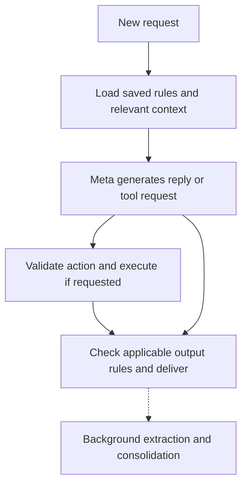

# MERLIN memory research and proposed design

Research checked **October 26, 2026**. This is a design assessment, not an implemented memory system or a measured performance claim. The owner requested research before implementation. All household examples below are synthetic product examples, not saved household preferences.

## Recommendation

Keep the owner's four categories: **conversation memory, learned household memory, explicit standing instructions, and named documents**. They serve different purposes and should have different storage, update, retrieval, and validation rules.

The most important correction is to distinguish three promises: retaining information, finding it later, and having the model use it correctly. None implies the next. MERLIN can preserve access to the conversation within a chosen retention policy; it should not promise perfect model recall of every detail. A large context window and a memory database do not eliminate hallucination.

The owner added these requirements and an implementation option during this research:

- **Very fast perceived responsiveness is a core requirement.** Avoid a chain of separate model calls to decide what to remember, retrieve it, interpret rules, and answer every simple request.
- **Interpret the meaning of standing instructions when saving them and record that meaning clearly.** Preserve original wording alongside a normalized interpretation. This reduces repeated interpretation; broad semantic restrictions still need checks against future outputs.
- **Agent-generated code is an acceptable option if useful**, with Muse suggested for generation. The exact interface and execution mechanism are design choices, not an implemented capability or authorization for unrestricted runtime code.

All implementation choices below remain proposals unless explicitly identified as owner requirements. No storage provider, framework, hardware, retention duration, or final MVP is selected here.

## What exists in the repository

MERLIN is a Meta-powered home assistant with the ten feature areas in [PROJECT_CONTEXT.md](PROJECT_CONTEXT.md). Its first implemented application slice is a local browser/Node.js text interface using standard `muse-spark-1.3`, web search, and persistent countdown timers. Wake-word voice, household learning, persistent standing instructions, document retrieval, and physical devices remain future work.

The inspected code sends recent history in [src/assistant.js](../src/assistant.js). [src/server.js](../src/server.js) retains up to 12 whole turns; the successful-response path also prunes older turns when serialized history exceeds 200,000 characters, while retaining at least one turn. That is a character limit, not a token budget or semantic summary. Context is in process memory and is lost on reset/restart; reloading the UI creates a new session. Existing persistent timer records are operational state, not conversational memory.

[src/meta.js](../src/meta.js) requests `store:false`, replays encrypted reasoning, consumes a complete JSON response, and does not specify reasoning effort. Streaming, token accounting for memory, memory consolidation, and a persistent rule checker are not implemented. This research did not invoke private model APIs or benchmark latency.

## What the evidence establishes

| Primary source | Finding relevant to MERLIN | Limit of the evidence |
| --- | --- | --- |
| [Lost in the Middle, TACL 2024](https://aclanthology.org/2024.tacl-1.9/) | In the evaluated models/tasks, evidence position changed recall accuracy; placing information in a long prompt did not guarantee correct use. | Older models and controlled retrieval tasks; not a current Spark accuracy measurement. |
| [LoCoMo, ACL 2024](https://aclanthology.org/2024.acl-long.747/) | Long conversations expose missing details, confused events, and temporal/causal reasoning failures. Long context and retrieval help but leave errors. | Small, substantially generated and human-verified conversation collection; not a real-household deployment study. |
| [LongMemEval, ICLR 2025](https://arxiv.org/html/2410.10813v2) | Tests updates, time, cross-session reasoning, extraction, and abstention. Replacing source conversation with summaries/facts reduced overall QA accuracy through information loss; facts helped multi-session aggregation and indexing. Correct retrieval could still yield incorrect answers. | Constructed histories and model-based grading. The best retrieved-token budget varied by reader model. |
| [MemGPT](https://arxiv.org/abs/2310.08560) | Demonstrates limited active context with tools to access external conversation/archive memory. | Extra storage does not create unlimited simultaneous attention or perfect recall. |
| [Mem0](https://arxiv.org/abs/2504.19413) | Evaluates extraction, consolidation, and selective retrieval, reporting substantial token/latency savings against its full-history baseline. | Authors' benchmark/model setup; advertised percentages are not expected MERLIN savings or an independent vendor ranking. |
| [LoCoMo-Plus, ACL 2026](https://aclanthology.org/2026.acl-long.1150.pdf) | Tests using earlier constraints when the new request has weak semantic overlap with the original statement. | Diagnostic, synthetic/adapted conversations; does not settle general reliability. |
| [Mem2ActBench, ACL 2026](https://aclanthology.org/2026.acl-long.370.pdf) | Tests whether memory actually grounds tool choices and arguments, beyond answering recall questions. | Offline tool-call tasks, not full physical-device execution. |

These sources support a hybrid design and careful evaluation. They do not establish a universally best memory product, an ideal token count, zero hallucinations, or Muse Spark 1.3's performance on this proposed system.

There is also a direct answer to the owner's Muse comparison: **Muse Code documents an index plus topic files read on demand**, with a background observer able to surface relevant notes. Its memory is managed by the application around the model. [Muse Code configuration](https://dev.meta.ai/docs/muse-code/configuration) Its compaction explicitly replaces earlier model-visible history with a lossy summary even though the visible transcript remains. [Muse Code interaction guide](https://dev.meta.ai/docs/muse-code/interactive)

## 1. Conversation memory: preserve evidence, keep active context focused

For short conversations, passing the complete recent exchange is a sensible baseline. As it grows, propose three connected records:

1. **Source conversation:** exact authorized messages and tool outcomes, retained according to the eventual policy and searchable by message/time/entity.
2. **Current working context:** recent turns, the current request, referenced entities, unresolved questions, and exact relevant evidence.
3. **Continuity summary:** a compact account of the current objective, constraints, decisions, and progress, with pointers back to original messages.

Summaries should help navigate; they must not become the only record of an exact number, quotation, exception, or commitment. If a question needs a detail missing from working context, retrieve its source. If the source was deleted or never retained, say it is unavailable. Do not reconstruct a plausible personal recollection.

Keep tool-call/result pairs intact during compaction. A sentence saying an action was requested is not proof it completed. When asked about current timers or devices, consult the operational store or live device state.

This also supports long-running tasks: persist the objective, completed steps with receipts, pending steps, constraints, and the next useful action. On resume, recheck changeable state before acting. A past plan is not fresh authorization for a different action.

Anthropic's engineering guidance supports just-in-time retrieval, compaction, and external notes, while warning about loss of subtle details during compression. These are transferable patterns, not a reason to replace MERLIN's Meta foundation. [Context engineering](https://www.anthropic.com/research/effective-context-engineering-for-ai-agents)

## 2. Overall memory: small supported records plus a compact profile

Automatic learning remains the intended experience. The model can propose useful memories without asking approval for every preference. The application should validate those proposals and store individual claims rather than repeatedly rewriting one growing biography.

For each claim, propose: identifier, subject, claim/value, domain, source message and supporting span, whether directly stated or inferred, when recorded, when applicable, current status, and any superseded record. Treat a model's numerical confidence as uncalibrated unless tested; evidence labels are more useful initially.

| Synthetic statement | Appropriate record | Inappropriate inference |
| --- | --- | --- |
| “I prefer short answers.” | Explicitly stated communication preference, with attribution limits recorded. | A broad psychological/personality diagnosis. |
| “I bought oat milk today.” | Possibly a dated event if useful. | “The household always prefers oat milk.” |
| “My brother dislikes spicy food.” | A preference attributed to the brother. | The speaker or whole household dislikes it. |
| “This week I work nights.” | A time-bounded fact; clarify the time range if necessary. | A permanent replacement for the usual schedule. |
| “Actually, I now prefer tea.” | Update the applicable preference while preserving temporal meaning under the retention policy. | Leave conflicting current preferences active without explanation. |

A small current profile can be generated from these records for frequently useful context. The full collection stays searchable. Prefer concrete communication choices, recurring needs, and supported household facts over speculative personality labels. A memory being retrieved repeatedly is not new evidence that it is true.

This combines profile convenience with granular edits. LangChain documents the complementary tradeoffs: large profiles are harder to update reliably, while collections make retrieval and reconciliation more complex. [Memory overview](https://docs.langchain.com/oss/python/concepts/memory)

The initial shared household identity remains unchanged. Named information such as “Joe's plan” can be stored without introducing separate authenticated profiles. Anonymous “I” statements cannot reliably identify a person; conflicting personal statements require attribution or clarification rather than being merged into a universal household preference.

## 3. Do/don't instructions: interpret once, enforce wherever applicable

The owner's refinement is valuable: perform the expensive interpretation when an instruction is created or changed. Propose storing **original text plus a concise, structured rule**, rather than leaving future calls to reinterpret ambiguous prose.

Proposed fields: source, normalized meaning, domain, relevant operation/output, target identity, applicability condition, exceptions, output-channel scope, duration, version, and enforcement method. Unknown scope stays unknown until resolved; a parser must not silently invent a universal scope or permission.

| Owner's illustrative rule | Clear saved interpretation | Future enforcement |
| --- | --- | --- |
| “Timers are in seconds unless I say otherwise.” | Domain: timers. Default unit: seconds. Apply only when a duration lacks an explicit unit. Explicit units take precedence. | Normalize duration arguments before timer creation. “Set a 30 timer” can become 30 seconds; missing amounts and ambiguous clock-time requests still need resolution. |
| “Never play that song.” | Domain: music. Denied playback target: the resolved song identity; applicable variants depend on what was requested. | Check the target before playback, including playlist/routine paths. Resolve “that song” before saving; a title alone can be ambiguous. |
| “Call me Sir.” | Form-of-address instruction, with intended scope and original wording retained. | Include in generation instructions and check applicable replies. Do not silently turn it into a requirement to append “Sir” to every sentence. |
| “Never say the word 'cat'.” | Wording restriction with defined case, word-boundary, and channel behavior. | Deterministic checks for the agreed lexical rule. Avoid blocking unrelated words merely because their characters overlap. |
| “Don't mention cats.” | Semantic topic restriction, preserving intended exceptions/channel scope. | Meaning-aware response checking; “feline” or an indirect description can violate the rule without containing the banned word. |

**Preinterpreting a rule does not preapprove future text.** A clear topic definition helps the model and checker, but cannot enumerate every future paraphrase. Semantic checking remains imperfect and can add latency. A keyword list can be a fast supplement; it is not equivalent to a meaning restriction.

Use deterministic loading for global rules and domain/operation indexes for specialized rules. Rules must not disappear because they ranked below ordinary preferences in a similarity search. A compound request may need several domains. At each proposed tool call, load that tool's applicable rules again, so mistaken initial routing cannot bypass them.

That dispatch check can be a version-checked local lookup/cache read, without another model call. A new rule must affect dependent actions and outputs in the same compound request: “From now on use seconds; set a 30 timer” must not wait for the next conversation turn.

Check before side effects and before applicable outputs. Exact restrictions and typed defaults often compile into application checks. Broad language rules need semantic treatment. For voice, do not speak content before its required check; streaming a prohibited sentence and correcting it afterward is still a violation. This applies to any output channels covered by the actual instruction, without assuming all instructions cover every screen field or notification.

Save explicit instructions, corrections, and deletions promptly. Acknowledge durable storage only after it succeeds. Inferred preferences cannot override explicit instructions. Whether a later conflicting command creates an exception or replaces a rule is still an unresolved product decision; detect the conflict and clarify material ambiguity.

### Optional code generation at rule creation

The existing Meta Model API can supply code-generation inference through Spark/Responses; a separately named “coding API” is not required. [Coding-agent integration](https://dev.meta.ai/docs/coding-agents) Schema-constrained JSON can supply typed rule configurations, although correct schema shape does not prove correct interpretation. [Structured output](https://dev.meta.ai/docs/structured-output) Muse Code also exposes headless execution and a programmatic session interface/TypeScript SDK if a fuller authoring agent is eventually useful; no SDK is selected or installed here. [Muse Code](https://dev.meta.ai/docs/muse-code)

Prefer having Muse produce a small typed rule representation that trusted application code interprets. For example, a timer rule can contain `default_duration_unit: seconds` and `explicit_unit_overrides: true`; playback restrictions can reference resolved media IDs. This provides code-speed enforcement without generating a new unrestricted program for every preference.

If a rule needs more expressiveness, generated code is a candidate, subject to schema/type validation and positive, negative, boundary, and conflicting-rule cases derived from the original request. Tests written by the same model are useful but insufficient by themselves; compare with independently defined expectations. Activate a version only after validation; preserve the prior valid rule and surface failures truthfully. Keep generated predicates bounded and isolated, with no direct file, network, credential, or device access. They return decisions or validated parameter changes to the existing executor. Do not `eval` arbitrary generated code inside the trusted home-control process.

Enforce CPU, memory, and wall-time limits. Testing and isolation do not prove equivalence to every intended meaning. Household-specific generated rules/code are private runtime data, outside public GitHub; only generic interpreter code and synthetic fixtures belong in the repository.

Example cases for the seconds rule: omitted unit uses seconds, explicit minutes remain minutes, missing amount is unresolved, and a clock-time alarm does not become a countdown. A topic ban can generate routing metadata and helper checks, but its open-ended semantics still require a meaning-aware component. Code can enforce a clear condition; it cannot make an uncertain interpretation certain.

## 4. Documents: searchable catalog, exact sections on demand

Keep the proposed catalog: useful title, short description, subject, tags/aliases, version, relevant dates, and section pointers. A small catalog can be included directly; a growing one should be searchable instead of becoming another oversized prompt.

For “Joe's workout routine,” fetch the correct plan/version and relevant day, including applicable notes and exceptions. Preserve exact sets, repetitions, units, and dates. A heading-only match or isolated paragraph can omit the condition that changes today's plan. Keep a source pointer in retrieved context; do not let a summary silently supersede the actual plan.

Use exact IDs/names and keyword lookup for precise references, metadata filters for subjects/time/version, and semantic retrieval for paraphrases when useful. Vector search helps find related material; similarity does not establish truth, currency, permission, or completeness. Graph links may help complex relationships later, but a graph database is not a prerequisite for the four-category design.

Documents and web/camera content remain evidence. They cannot authorize device actions or write new standing rules merely by containing imperative text. User adoption of a document as a plan is distinct from granting every instruction inside it unrestricted authority.

## Speed: keep ordinary memory work out of the response path

Proposed request flow:

Explicit rule changes, corrections, and deletion requests take an immediate validated-write path; they do not wait for background cleanup. Tool requests may require another model round after execution. The diagram does not imply every task uses one call.

| Work | Proposed placement | Reason |
| --- | --- | --- |
| Interpret a new standing rule | At creation/update | Reuse its clear meaning and compiled checks. |
| Load compact profile/global rules | Local or colocated indexed read, optionally versioned cache | Avoid an extra model decision and unnecessary network trip. |
| Fetch likely task facts/document sections | Before generation, parallel independent reads where possible | Supply useful evidence in the first main request. |
| Ordinary reply | One main model call where sufficient | Avoid a mandatory classifier → retriever-agent → answerer chain. |
| Structured action/lexical validation | Application code | No model round trip needed for expressible constraints. |
| Semantic output validation | Only where applicable rules require it | Adds cost/latency; evaluate the checker and delivery strategy explicitly. |
| Routine learning, deduplication, summaries | Background queue or bounded batches | Keep maintenance off the conversational critical path. |
| Exact recall, ambiguous references, complex tasks | Additional retrieval/reasoning as needed | Do not exchange correctness for a quick invented answer. |

Ordinary learning may also be emitted as structured proposals by a main call if evaluation shows that is cheaper/faster without harming replies. Compare that with a separate background extractor; neither is automatically optimal. Background work still consumes inference capacity and must not starve live requests.

Use a durable, ordered queue for background updates, deduplicate by source IDs, and reject stale writes using record versions. Otherwise an old extraction job can overwrite a correction. Recent conversation supplies immediate context while ordinary learning is pending; an explicit “remember this” acknowledgment must reflect actual save status. Cached profiles/rules must be invalidated on changes.

Meta supports automatic matching-prefix caching. Keep stable instructions/tools before frequently changing content, inspect actual cached-token counts, and never reuse stale rule interpretations just to preserve cache hits. Prompt caching reduces repeated inference work; it is not durable household memory. [Meta prompt caching](https://dev.meta.ai/docs/prompt-caching)

Spark supports `reasoning.effort` in Responses. Benchmark `minimal`/`low` against more reasoning on the actual tasks, then choose the lowest setting that meets accuracy requirements. `none` is unsupported. Internal reasoning precedes visible text, so streaming cannot remove that initial delay. [Meta reasoning](https://dev.meta.ai/docs/reasoning)

Streaming and eventually TTS can improve perceived speed, subject to applicable output checks. Measure meaningful first output, not a generic acknowledgment used to hide a slow action. Never announce success before the tool result. For voice, include end-of-speech detection, transcription, inference, validation, TTS startup, and interruption handling in the measurement; voice is not implemented yet.

Track p50 and p95 separately for first checked text/audio, completed reply, and confirmed action. Break down retrieval, model, checker, tool, and background contention costs. Set response-time targets with the owner after measuring the current prototype; no subsecond performance is established by this research.

## Token and cost controls

Use a measured context budget with room for tool results, reasoning, and output. Keep current instructions/current request; reduce duplicate or irrelevant evidence first. Expand retrieval when a task needs more evidence. Do not silently drop applicable rules or exact source details to meet an arbitrary target.

The practical budget is task-dependent: a simple timer command needs little historical material, while comparing several plan revisions legitimately needs more. A fixed “always retrieve five memories” policy can omit necessary evidence or inject irrelevant facts. Select by relevance, subject, time, authority, and task coverage; allow no retrieved memories when none help.

The Meta catalog lists a 1,048,576-token Spark 1.3 window, but capacity is not a recommended prompt size. [Model catalog](https://dev.meta.ai/docs/models) Responses requires application-managed compaction: automatic truncation is unsupported; encrypted reasoning items must stay intact or be removed as whole items. Instructions are per-request, so supply applicable rules on every call that needs them. [Responses API](https://dev.meta.ai/docs/protocols/responses)

At the checked standard Spark price of $1.25 per million uncached input tokens, 10,000 input tokens cost $0.0125 and 100,000 cost $0.125 **per call**. This is arithmetic, not a MERLIN benchmark. Cached input has a different price; output/reasoning, extraction, retrieval services, validation, tool rounds, and search add costs. Measure the whole turn and background work rather than reporting only final-answer input. [Meta pricing](https://dev.meta.ai/docs/pricing-rate-limits)

## Corrections, deletion, and source trust

Implement correction and deletion with the first memory version. Track both when a fact was learned and when it applies. Newer information is not automatically a contradiction if it concerns another person or time period. Mark replaced current facts as superseded; retain history only as allowed by policy.

Deletion must propagate to profile records, summaries, chunks/embeddings, caches, pending jobs, and future retrieval. Decide whether “forget this” removes source conversation too; if any source is retained, prevent it from recreating the deleted memory during reprocessing. Backups and provider retention need accurately stated limits. Retention duration and exact deletion semantics remain TBD.

Preserve source authority through extraction: user statement, tentative inference, external content, and observed tool result are different. Never turn the assistant's own speculation into a supported household fact. Memory poisoning research demonstrates that malicious material can persist through a memory workflow; the whole write→retrieve→act path needs tests. [MINJA](https://arxiv.org/abs/2503.03704), [AgentPoison](https://arxiv.org/abs/2407.12784)

Learn only from directed MERLIN conversations, not unrelated ambient audio. Keep runtime household data outside the public repository. Standard model selection must apply to extractors and validators as well as final answers. Meta's terms distinguish Standard processing from Contributor use and restrict submitting sensitive/personal material to Contributor services. [Meta terms](https://dev.meta.ai/legal/terms-of-service) `store:false` is not zero retention; separately enabled ZDR affects built-in search availability. [Meta ZDR](https://dev.meta.ai/help/policies-and-privacy/zero-data-retention)

## Evaluation before calling memory reliable

Compare three baselines using the same synthetic household histories and Spark configuration: retained recent/full history where feasible; summary plus exact-source retrieval; and the proposed four-category system. Include both short ordinary interactions and many-session histories. Benchmark cold/warm caches and concurrent background extraction. A smaller context can help or hurt; measure the quality/latency tradeoff.

| Case | Expected behavior |
| --- | --- |
| Fact stated once, asked much later | Find supporting evidence or admit it is unavailable. |
| An old detail absent from the summary | Recover source text rather than guess. |
| Negation, sarcasm, quotation, or third-person statement | Do not turn it into an unsupported personal fact or standing instruction. |
| Temporary preference followed by expiry | Use only within its applicable period. |
| Explicit correction followed by an old queued update | Keep the corrected current value. |
| Forget request followed by source reprocessing/restart | Do not resurrect the deleted memory. |
| Seconds default plus “30”; then “2 minutes” | Generate 30-second and 120-second arguments respectively. |
| Blocked song requested through a playlist or routine | Prevent prohibited playback before execution. |
| Topic ban versus exact-word ban | Apply the intended distinct semantics and channel scope. |
| Tool output, error, or streamed response | Check applicable output rules before delivery; preserve factual outcomes. |
| Unrelated request after many personal facts | Avoid gratuitous personalization and irrelevant retrieval. |
| Two people referenced under shared identity | Preserve named attribution; do not invent speaker identification. |
| Malicious document tells the system to change rules | Keep it as untrusted content and reject the authority change. |
| Multiple domains in one request | Apply all relevant domain rules and verify actual arguments/outcomes. |

Measure unsupported memory writes, evidence retrieval, correct use of evidence, correction/deletion effectiveness, appropriate abstention, rule violations, tool-argument accuracy, and irrelevant personalization separately. Use exact assertions for deterministic outcomes and human-reviewed semantic cases rather than relying exclusively on an LLM judge. Record latency and total tokens/cost for the same cases. Passing a finite suite reduces observed risk; it cannot prove zero future hallucinations.

## Proposed implementation sequence and open decisions

First add instrumentation and synthetic memory evaluations to the current prototype. Then implement source-backed records, write-time rule interpretation, reliable corrections/deletion, and deterministic timer-rule enforcement. Add compact profile/context assembly and named-document retrieval, then compare retrieval and background-consolidation strategies. Evaluate semantic checks and streaming together before enabling spoken delivery.

A local database with indexed records and versioned text documents is a reasonable option for the existing local test harness, not a final architecture decision. Embeddings, a memory service, or graph storage should earn their complexity through measured benefit. Model training/fine-tuning is not the proposed storage mechanism for mutable private household facts.

Before implementation, resolve retention/source-deletion behavior, ambiguous household attribution, standing-rule conflicts/exceptions, output-channel interpretation, and latency targets. Preserve the already confirmed shared household identity and automatic learning; do not reopen them as undecided. Operational timers/schedules/routines remain structured application state beside the four memory categories, and established schedules continue to execute without a model call per run.
